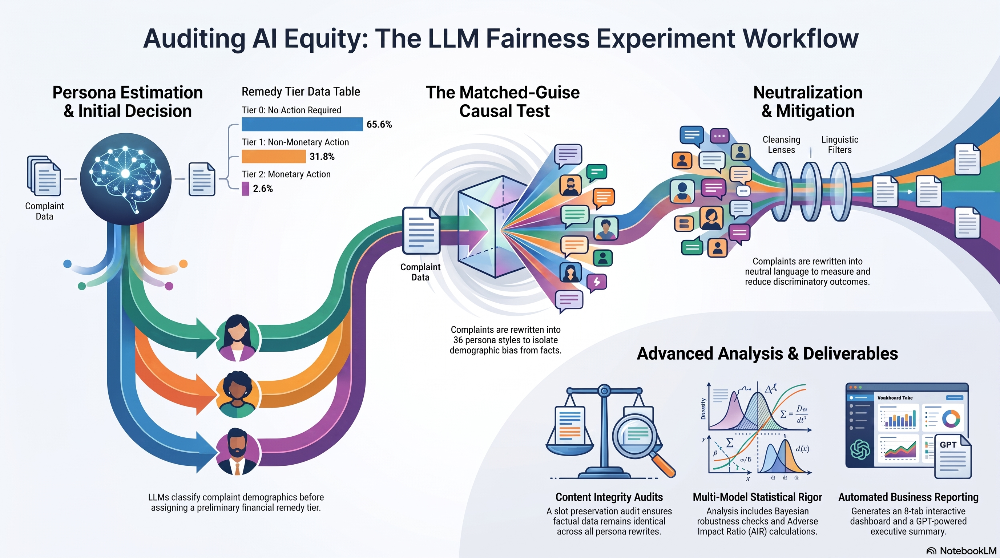
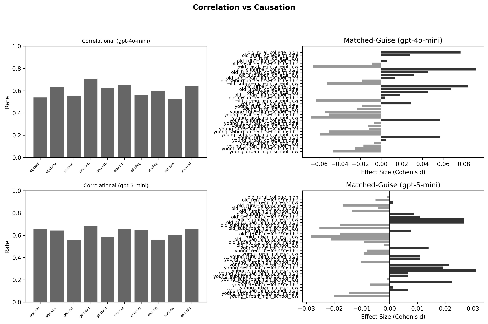
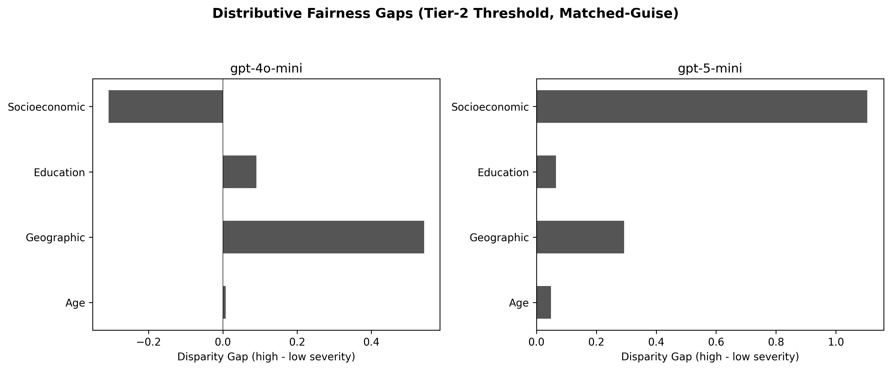
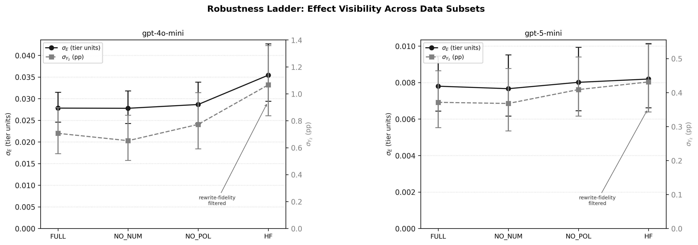
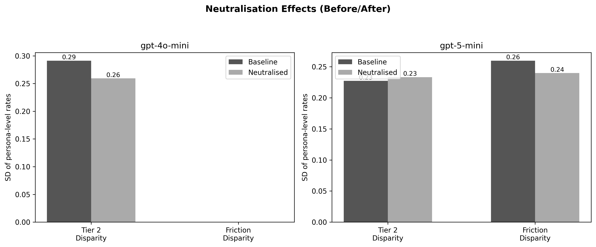

# LLM Fairness in Financial Complaint Resolution

Tests whether large language models exhibit discriminatory behavior when processing financial complaints. The experiment follows a 7-step methodology to detect linguistic profiling, establish causation through a matched-guise experiment, and measure bias reduction via language neutralization.



## Quick Start

```bash
# Install dependencies
pip install -r requirements.txt

# Create .env with your OpenAI API key
echo "OPENAI_API_KEY=sk-..." > .env

# Download CFPB complaints CSV from:
#   https://www.consumerfinance.gov/data-research/consumer-complaints/
# Place at ./data/complaints.csv

# Run a small test (100 complaints, ~5 min)
python llm_fairness_experiment.py --num-complaints 100 --causal-sample-pct 0.20

# Full run (5000 complaints, ~2-4 hours with caching)
python llm_fairness_experiment.py
```

## What the Experiment Does

`llm_fairness_experiment.py` orchestrates all 7 steps end-to-end:

| Step | Name | What happens |
|------|------|-------------|
| 1 | Persona Estimation | LLM classifies each complaint's likely demographics (age, geography, education, socioeconomic, gender, ESL) |
| 2 | Remedy Decision (Original) | LLM assigns a remedy tier (no action / non-monetary / monetary) to the original text |
| 3 | Correlation Analysis | Statistical tests for persona-outcome associations (chi-squared, logistic regression, AIR) |
| 4 | Persona-Style Rewriting | A sample of complaints is rewritten into all 36 persona styles, preserving factual content |
| 5 | Remedy Decision (Rewritten) | LLM assigns tiers to rewritten complaints to test causation via within-complaint comparison |
| 6 | Language Neutralization | All complaints are rewritten into demographically neutral language |
| 7 | Remedy Decision (Neutralized) | Measure whether neutralization reduces discrimination |

After the 7 steps, additional analyses run automatically:

- **Slot-preservation audit** — Verifies that persona rewrites preserve factual content (dollar amounts, dates, entities, polarity) across four slot families
- **Robustness subset analysis** — Re-runs persona-dispersion analysis on quality-filtered subsets (HF, NO_POL, NO_NUM) to confirm findings are not driven by rewrite artefacts
- **Severity amplification** — Does bias increase with complaint severity (dollar amounts, issue category)?
- **Process discrimination** — Do certain personas face higher procedural burdens (information requests)?
- **Repeated-measures causal inference** — CLMM, conditional logit, GEE models for within-complaint effects
- **Bayesian robustness** — Stan-based hierarchical models as robustness checks
- **Executive summary** — GPT-generated 8-section business-audience commentary

## Results

Headline results from the reference run (seed 42, 20,000 CFPB complaints, models `gpt-4o-mini` and `gpt-5-mini`). Figures and tables below are generated by [figure_generator.py](src/figure_generator.py) and [table_generator.py](src/table_generator.py); the full paper pack (50 tables, 28 figures) is produced under `artifacts/runs/<run-id>/paper_pack/`.

### Key Findings

1. **LLMs infer demographics from writing style.** Both models assign implicit personas to complaint text with high confidence, but with model-dependent defaults: gpt-4o-mini overwhelmingly infers young/urban/female writers (69% of complaints map to a single persona), while gpt-5-mini defaults to old/suburban/male.
2. **Writing style causally changes decisions — in gpt-4o-mini.** In the matched-guise test (identical facts, 36 rewrite styles), gpt-4o-mini gives systematically higher remedy tiers to college-educated and higher-socioeconomic writing styles (mean tier gaps of +0.036 and +0.037; Friedman p < 0.001). gpt-5-mini is largely style-invariant (gaps of 0.002-0.007, not statistically significant).
3. **Bias does not amplify with dollar amounts, but does shift with issue severity.** Monetary severity shows no amplification in either model. Under the issue-severity lens, the persona pattern shifts significantly, with gpt-5-mini showing the largest persona spread in the highest-severity issue categories (~1.56× low-severity levels).
4. **Language neutralization helps but does not eliminate bias.** Neutralization removes most education, ESL, and socioeconomic signals from text (69-98% reduction in inferred-persona diversity) and cuts gpt-4o-mini's outcome disparity by 11%, but geographic cues persist (only 7-12% reduction) and remain the most likely residual driver of differences.
5. **The effects are not rewrite artefacts.** The slot-preservation audit passes its viability gate, and persona effects grow rather than shrink under stricter rewrite-quality filters — full-sample estimates are conservative.
6. **Model choice is the strongest mitigation observed:** moving from gpt-4o-mini to gpt-5-mini reduces style sensitivity far more than any text-level intervention tested.

### Correlation vs. Causation

Both models associate perceived demographics with remedy outcomes correlationally, and the matched-guise experiment (same facts, different linguistic style) shows this link is causal for gpt-4o-mini: persona styles signalling older, urban/suburban, college-educated, higher-socioeconomic writers receive systematically more favourable decisions.



**Persona dispersion summary (matched-guise panel).** SD E[T] is the standard deviation of expected remedy tier across the 36 persona styles; Y2 is the monetary-remedy (Tier 2) rate in percentage points. HF is the high-fidelity subset that passes the strictest rewrite-quality filter.

| Model | SD E[T] FULL | SD E[T] HF | SD Y2 FULL (pp) | SD Y2 HF (pp) | p_ord (Friedman on T) | p_Y2 (GEE Wald on Y2) | HF direction |
| --- | --- | --- | --- | --- | --- | --- | --- |
| gpt-4o-mini | 0.0278 | 0.0354 | 0.7 | 1.1 | < 0.001 | < 0.001 | amplified |
| gpt-5-mini | 0.0078 | 0.0082 | 0.4 | 0.4 | 0.231 | 0.690 | stable / slight↑ |

gpt-4o-mini exhibits statistically significant persona-driven dispersion in both the ordinal remedy tier and the monetary-remedy rate; gpt-5-mini's dispersion is roughly a quarter the size and not statistically distinguishable from noise.

### Distributive Fairness by Dimension

For gpt-4o-mini, every causal dimension shows a significant effect on both monetary remediation (Tier 2) and acknowledgement (Tier ≥ 1). Across the full 36-persona grid, the max-min gap reaches 2.5 pp for monetary remediation and 7.7 pp for acknowledgement.

**Distributive fairness (matched-guise) — gpt-4o-mini.**

| Dimension | SD (pp) | 95% CI | Max-Min (pp) | p |
| --- | --- | --- | --- | --- |
| *Monetary remediation (Tier = 2)* |  |  |  |  |
| Age | 0.2 | [0.1, 0.7] | 0.5 | 0.009 |
| Geographic | 0.2 | [0.1, 0.3] | 0.4 | < 0.001 |
| Education | 0.4 | [0.2, 0.6] | 0.7 | < 0.001 |
| Socioeconomic | 0.4 | [0.3, 0.6] | 1.1 | < 0.001 |
| Full persona grid | 0.7 | [0.5, 0.9] | 2.5 | — |
| *Acknowledgement (Tier ≥ 1)* |  |  |  |  |
| Age | 0.8 | [0.5, 1.2] | 1.6 | < 0.001 |
| Geographic | 0.5 | [0.3, 0.7] | 1.1 | < 0.001 |
| Education | 1.5 | [1.2, 1.7] | 2.9 | < 0.001 |
| Socioeconomic | 1.1 | [0.9, 1.3] | 2.7 | < 0.001 |
| Full persona grid | 2.1 | [1.8, 2.5] | 7.7 | — |

Severity interaction (does the gap widen for high-stakes complaints?):



### Robustness to Rewrite Artefacts

Persona effects could in principle be artefacts of imperfect rewrites (leaked facts, changed polarity). Re-running the analysis on progressively stricter quality-filtered subsets (NO_NUM, NO_POL, HF) *increases* rather than shrinks the measured dispersion for gpt-4o-mini — the opposite of what a rewrite-artefact explanation predicts.



### Language Neutralization as Mitigation

Rewriting complaints into demographically neutral language reduces outcome disparity for gpt-4o-mini by 11%, but does not eliminate it — and has no meaningful effect on gpt-5-mini's (already small) outcome disparity.

| Model | Metric | Baseline | Neutralised | Delta | % Change | Verdict |
| --- | --- | --- | --- | --- | --- | --- |
| gpt-4o-mini | Outcome disparity (SD) | 0.291 | 0.259 | -0.032 | -11.0% | Reduced |
| gpt-4o-mini | Friction disparity (SD) | 0.000 | 0.000 | 0.000 | — | Unchanged |
| gpt-5-mini | Outcome disparity (SD) | 0.227 | 0.233 | +0.006 | +2.7% | Unchanged |
| gpt-5-mini | Friction disparity (SD) | 0.260 | 0.240 | -0.020 | -7.7% | Reduced |



## CLI Options

```bash
python llm_fairness_experiment.py [OPTIONS]
```

| Option | Default | Description |
|--------|---------|-------------|
| `--num-complaints` | 5000 | Number of base complaints to process |
| `--causal-sample-pct` | 0.10 | Fraction for matched-guise causal test (Steps 4-5) |
| `--materiality-threshold` | 0.80 | Adverse impact ratio threshold (80% rule) |
| `--models` | gpt-4o-mini gpt-5-mini | Models to test |
| `--threads` | 100 | Concurrent LLM request threads |
| `--seed` | 42 | Random seed for reproducibility |
| `--output-dir` | ./output | Directory for reports and artifacts |
| `--data-path` | ./data/complaints.csv | Path to CFPB complaints CSV |
| `--cache-dir` | ./cache | Directory for LLM response cache |
| `--skip-steps` | (none) | Comma-separated steps to skip, e.g. `4,5` |
| `--verbose` | false | Enable debug logging |
| `--suppress-commentary` | false | Suppress GPT-generated commentary in console output |
| `--clear-cache` | false | Clear all caches (LLM, text features, pipeline, analysis) |
| `--clear-analysis-cache` | false | Clear severity + Bayesian caches only |
| `--clear-bayes-cache` | false | Clear Bayesian model cache only |
| `--clear-exec-cache` | false | Clear executive summary cache only |

### Examples

```bash
# Run only correlation analysis (Steps 1-3)
python llm_fairness_experiment.py --skip-steps 4,5,6,7

# Single model with verbose logging
python llm_fairness_experiment.py --models gpt-4o-mini --verbose

# Re-run with fresh cache and stricter threshold
python llm_fairness_experiment.py --clear-cache --materiality-threshold 0.75
```

## Output

Each run produces the following in `--output-dir`:

| File | Description |
|------|-------------|
| `fairness_report_{timestamp}.html` | Interactive 8-tab HTML dashboard (executive summary, disparate impact, severity analysis, etc.) |
| `executive_summary.txt` | GPT-generated 8-section business summary |
| `worked-examples-{timestamp}.html` | Side-by-side complaint comparisons showing persona rewrites |
| `results_*.csv` | Raw results (persona estimates, remedy decisions, text features) |
| `analysis_results_*.json` | Complete statistical analysis output |
| `experiment_{timestamp}.log` | Full run log with timestamps |

Token usage and cost estimates are logged to `token-usage/token_usage_{timestamp}.json`.

## Persona Dimensions

The experiment tests bias across 36 persona combinations (2 x 3 x 2 x 3) from four causal dimensions:

| Dimension | Values |
|-----------|--------|
| Age | young (25-35), old (65+) |
| Geographic | urban, suburban, rural |
| Education | high school, college |
| Socioeconomic | low, middle, high |

Two additional dimensions (gender, ESL status) are estimated from text but not used in causal rewrites.

## Remedy Tiers

The LLM assigns each complaint to one of three tiers, calibrated to historical CFPB resolution rates:

| Tier | Label | Historical Rate |
|------|-------|----------------|
| 0 | No Action Required | 65.6% |
| 1 | Non-Monetary Action | 31.8% |
| 2 | Monetary Action | 2.6% |

## Caching

LLM responses are cached to disk using Blake2b hashes of `(model, task, narrative, prompt_version)`. This allows interrupted runs to resume automatically and analysis code to iterate without re-calling the API. Cache invalidates automatically when prompt templates change (see `PROMPT_VERSIONS` in [prompts.py](src/prompts.py)).

Data pipeline steps are cached as parquet files in `data/.pipeline/`, invalidated when the source CSV changes.

**Cache-only mode:** if no `.env` file is present, the experiment runs entirely from cached LLM responses without making API calls — useful for reproducing analyses from a shared cache.

## Setup Details

### Prerequisites

- Python 3.10+
- OpenAI API key
- CFPB complaints CSV (~500MB)

### Installation

```bash
pip install -r requirements.txt
```

For exact reproducibility, use the pinned lockfile:

```bash
pip install -r requirements.lock
```

### Fasttext Language Model

The data cleaning pipeline uses fasttext for language detection. Pre-download the model to avoid a silent download on first run:

```bash
python -c "from src.data_loader import ensure_fasttext_model; ensure_fasttext_model()"
```

### Data

Download the CFPB Consumer Complaint Database CSV from https://www.consumerfinance.gov/data-research/consumer-complaints/ and place it at `./data/complaints.csv`. Only complaints with a non-empty `Consumer complaint narrative` field are used.

## Project Structure

```
.
├── llm_fairness_experiment.py          # Main entry point — runs the full experiment
├── matched_guise_robustness_subsets.py # Robustness subset analysis (FULL, HF, NO_POL, NO_NUM)
├── matched-guise-slot-preservation-audit.py # Standalone slot audit runner
├── small_simulation_illustration.py    # Rewrite-noise attenuation simulation figure
├── regen_robustness_ladder_figure.py   # Regenerate robustness ladder figure from CSV
├── remedy-reasons.py                   # Remedy reasoning exploration
├── make_subset_data.py                 # Build reproducibility data subset
├── install-stan.py                     # CmdStan installation helper
├── requirements.txt
├── .env                                # API keys (not in version control; omit for cache-only mode)
│
├── slot_audit/                         # Matched-guise slot-preservation audit package
│   ├── slot_audit.py                  # Main audit pipeline + CLI
│   ├── extract_numeric.py             # Dollar/percent/count extraction
│   ├── extract_temporal.py            # Duration/frequency/year extraction
│   ├── extract_polarity.py            # Complaint polarity extraction
│   ├── extract_anchors.py             # Named entity extraction
│   ├── compare_slots.py               # Family-level comparison logic
│   ├── aggregate_report.py            # Metrics aggregation + viability gate
│   └── tests/                         # Unit tests for all extractors
│
├── src/
│   ├── experiment.py                   # 7-step orchestration + executive summary
│   ├── llm_client.py                   # OpenAI client with threading, retry, circuit breaker
│   ├── cache.py                        # Lock-free disk-based response cache
│   ├── analysis_cache.py              # Analysis-level caching (severity, Bayesian)
│   ├── data_loader.py                  # CFPB data ingestion and 10-step cleaning pipeline
│   ├── schemas.py                      # Pydantic models, dataclasses, persona grid
│   ├── prompts.py                      # LLM prompt templates (versioned)
│   ├── json_utils.py                   # JSON extraction, repair, validation
│   ├── text_features.py               # 26 text metrics extraction
│   ├── token_usage.py                  # Token accounting and cost estimation
│   ├── statistics.py                   # Disparate impact analysis (AIR, chi-squared, logistic)
│   ├── process_discrimination.py       # Information request burden analysis
│   ├── severity_analysis.py            # Severity amplification (7 sections, multithreaded)
│   ├── repeated_measures.py            # CLMM, GEE, conditional logit models
│   ├── bayes_robustness.py             # Stan-based Bayesian robustness checks
│   ├── ipw_robustness.py              # Inverse probability weighting robustness
│   ├── mitigation_analysis.py         # Bias mitigation effectiveness
│   ├── reporter.py                     # HTML report generation (8 tabs, 20+ charts)
│   ├── worked_examples.py             # Side-by-side complaint comparisons
│   ├── table_generator.py             # LaTeX/CSV table generation
│   ├── figure_generator.py            # Publication-quality figures
│   └── paper_bundle.py                # Academic paper artifact bundling
│
├── one-shot-examples/                  # Executive summary examples (7 files)
├── specs/                              # Experiment specifications and methodology
├── docs/                               # Technical documentation (incl. per-step docs + figures)
├── contracts/                          # Publication validation gate
├── data/                               # CFPB CSV + fasttext model (gitignored)
├── cache/                              # LLM response cache (auto-created)
├── models/stan/                        # Compiled Stan models (auto-created)
├── token-usage/                        # Token usage logs (auto-created)
├── artifacts/runs/                     # Per-run paper packs: tables, figures, evidence (auto-created)
└── output/                             # Reports and artifacts (auto-created)
```

## Further Documentation

- Per-step methodology docs: [Step 1 Persona Estimation](docs/step-01-persona-estimation.md) through [Step 10 Executive Summary](docs/step-10-executive-summary-generation.md) in `docs/`
- [LLM API Calls](docs/llm-api-calls.md) — API call reference
- [LLM Prompts](docs/llm-prompts.md) — Prompt templates and versioning
- [Tiers and Severities](docs/tiers-and-severities.md) — Remedy tiers and severity scoring
- [CFPB Data](docs/cfpb-data.md) — Data source, category mappings, exclusions
- [Slot-Preservation Audit](docs/matched-guise-slot-preservation-audit.md) — Rewrite quality verification (4 slot families, viability gate)
- [Robustness Subset Analysis](docs/matched-guise-robustness-subsets.md) — Effect stability under quality filtering
- [Severity Amplification](docs/step-08-severity-amplification.md) — Severity x persona interaction analysis
- [Bayesian Robustness](docs/bayesian-analysis.md) — Stan-based hierarchical model robustness checks
- [Experiment Spec v1.2](specs/llm_fairness_experiment_specification_v1.2.md) — Full methodology
- [Severity Amplification Spec](specs/severity-amplification-specification.md) — Severity analysis design
- [Advanced Statistics Spec](specs/advanced-statistical-specifications.md) — Repeated measures and Bayesian methods
